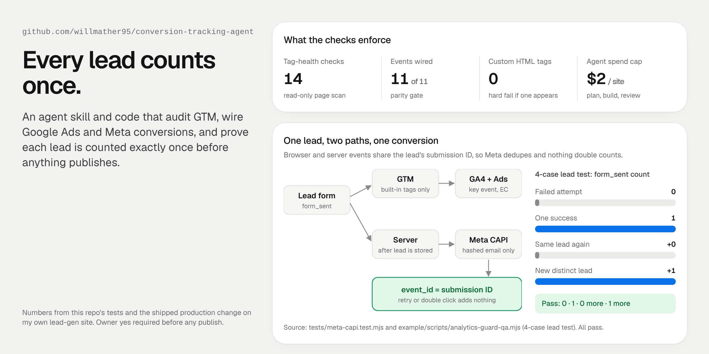

# conversion-tracking-agent



An agent skill plus working code for the part of marketing that usually breaks without anyone noticing: conversion tracking. It audits Google Tag Manager, wires GA4, Google Ads and Meta conversions, and proves that each lead is counted exactly once **before** anything publishes.

I built this for my own lead-gen sites. Everything here is sanitized: container IDs, keys and site details are placeholders.

## What it does

| Piece | What it's for |
|---|---|
| [`skills/gtm-audit-publish/`](skills/gtm-audit-publish/SKILL.md) | An agent skill (Claude Code, Codex, Grok Bot) for auditing, fixing and publishing GTM containers. Read-only by default, fixes go in a separate workspace, and nothing publishes without the owner's yes. 11 reference docs: audit checklist, Ads conversions, Consent Mode v2, server-side, naming, scorecard, test protocol. |
| [`src/tag-health/`](src/tag-health/) + `bin/tag-health.mjs` | A read-only scanner with 14 checks for any public page: GTM, duplicate GA4, Google Ads, Meta, TikTok, LinkedIn, UET, consent default, CMP, tag order, server-side signals, broken snippets. It has an SSRF guard, size and redirect limits, and rate limits. |
| [`src/meta-capi/`](src/meta-capi/meta-capi.ts) | A server-side Meta Conversions API sender. It hashes the email, builds `fbc` from the click ID, and sets `event_id` to the lead's submission ID so the browser and server events dedupe. |
| [`example/`](example/) | The tracking layer from a production Next.js lead site: one event spec shared by GTM, GA4 and PostHog, an internal-traffic and GPC guard, a double-submit guard, and an exported GTM container. |
| [`example/scripts/`](example/scripts/) | Two gates that run before merging. `gtm-parity-qa.mjs` fails if code events and GTM triggers drift, or if any Custom HTML tag appears. `analytics-guard-qa.mjs` runs the 4-case lead test. |
| [`tools/capped.py`](tools/capped.py) | The cost-cap runner I used to let plan, build and review agents work across five sites. Hard caps: $2 per site, $10 total. |
| [`case-studies/`](case-studies/01-tracking-hardening.md) | The real change, written up: spec, agents, review, merge on one approved SHA, live check. |

## How it works

```
Lead form ──► dataLayer ──► GTM (built-in tags only) ──► GA4 key event + Google Ads conversion
    │
    └──► server stores lead ──► Meta CAPI (hashed email, event_id = submission ID)
                                     ▲
             browser Pixel, same event_id ──┘   → Meta keeps one, nothing double counts
```

1. **One event spec.** `events.ts` names every event once (`lead_form_start`, `form_sent`, ...). GTM triggers, GA4 key events and PostHog all read from it.
2. **One choke point.** Every event goes through `push()`. Internal traffic (`?<site>_internal=1`, sticky) and preview hosts are dropped there, so GA4 and PostHog stay clean together.
3. **Count outcomes, not clicks.** `form_sent` fires only after the server confirms the lead was stored. A failed submit fires `form_invalid` or `form_undelivered` instead.
4. **Prove it before publishing.** The parity gate and the 4-case lead test run locally and in review. The agent skill's test protocol repeats them in GTM Preview, and nothing goes live until the owner says yes.

## Results

From the production change in [case study 1](case-studies/01-tracking-hardening.md) (Oct 22, 2026):

| | |
|---|---|
| Live checks on production | **9 of 9 PASS**: GTM once, GA4 fires, internal flag kills GTM + GA4 + PostHog, GPC respected, 0 console errors |
| 4-case lead test | **0 · 1 · 0 more · 1 more**: failed, success, same lead again, new lead |
| Events in parity (code ↔ GTM) | **11 of 11** |
| Custom HTML tags in the container | **0** |
| Agent spend | **$7.01** across a five-site run, with a $10 hard cap |
| Time from spec to live | same day, merged on the exact approved commit, no force push |

## Run it

Node 22.18+ is required, with no install step and no dependencies.

```bash
npm test                                   # all five suites below
npm run test:ssrf                          # scanner refuses private, local and odd hosts
npm run test:detect                        # 14 checks against an offline fixture page + container
npm run test:meta                          # CAPI payload: hashing, fbc, event_id, dedupe
npm run test:parity                        # code events ↔ GTM container, no Custom HTML
npm run test:lead                          # internal/GPC guard + 4-case lead test

npm run scan -- https://example.com        # live scan of a public page (add --json)
```

The live scan needs normal DNS. Sandboxes that fake DNS answers resolve every host to a private address, so the SSRF guard correctly refuses them. Use `test:detect` there.

## Layout

```
skills/gtm-audit-publish/   SKILL.md + references/
src/tag-health/             scanner (fetch, ssrf, detect, patterns, format)
src/meta-capi/              server-side Conversions API
example/                    Next.js tracking layer + GTM export + QA gates
tests/                      offline tests and made-up fixtures
tools/capped.py             agent cost caps
case-studies/               the production write-up
```

## License

MIT. IDs in `example/gtm-container.json` and the fixtures are placeholders (`GTM-XXXXXXX`, `G-XXXXXXXXXX`, `GTM-ABC1234`).
